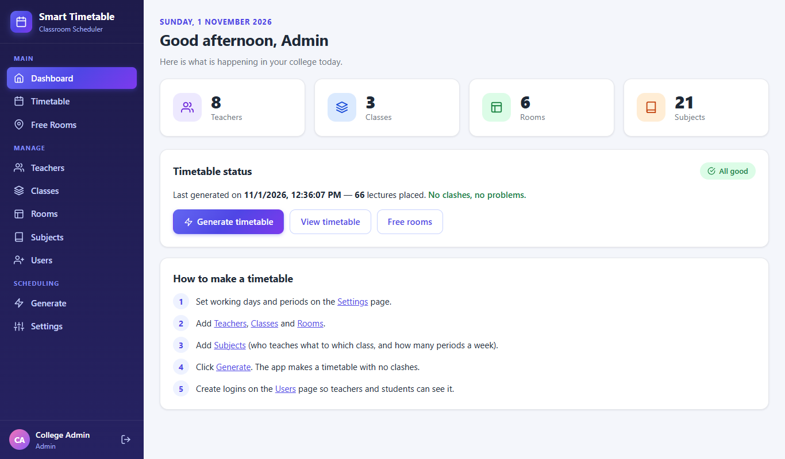
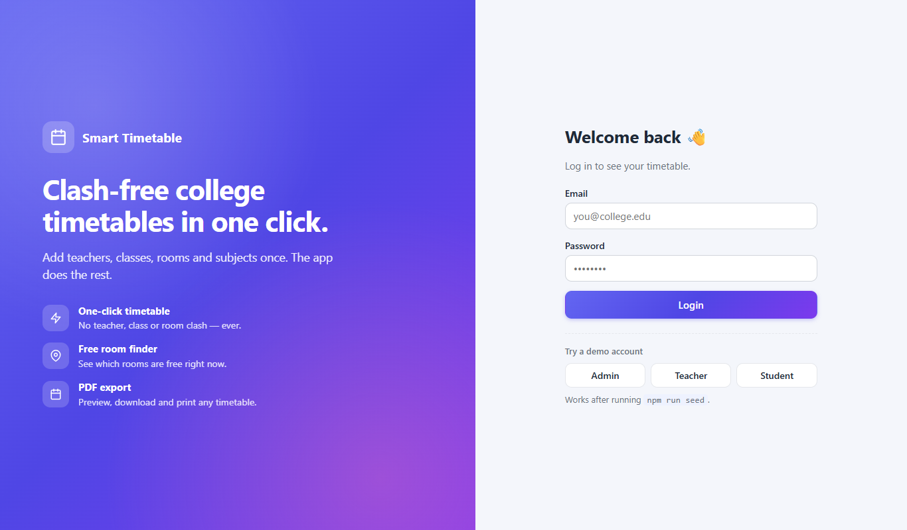
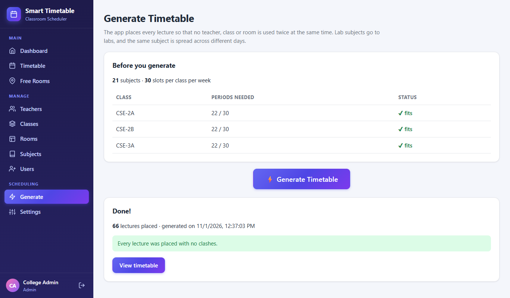
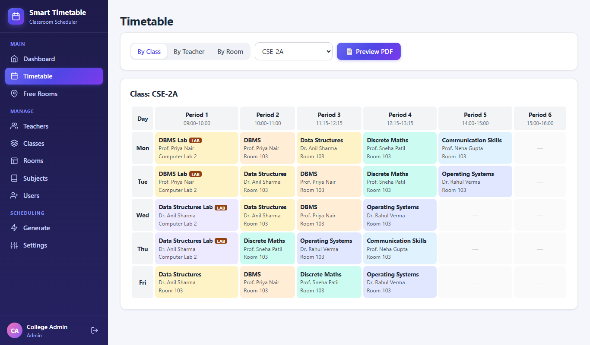
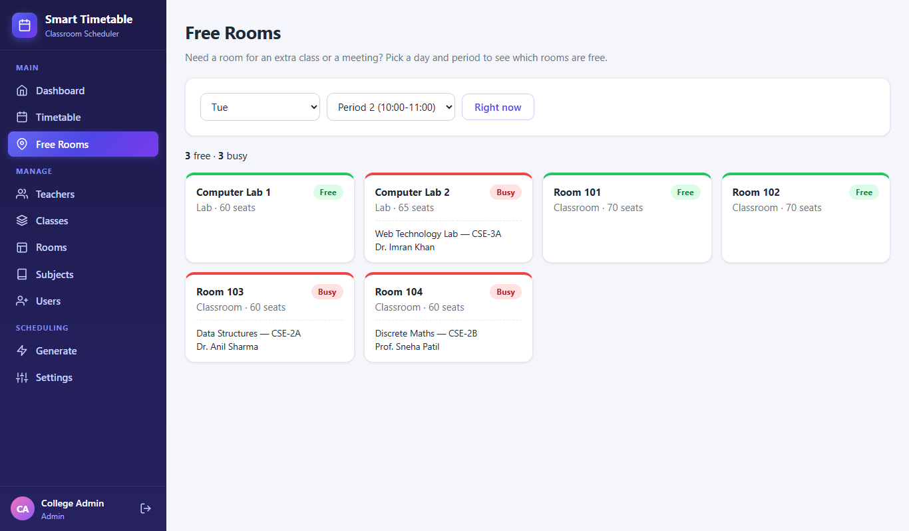
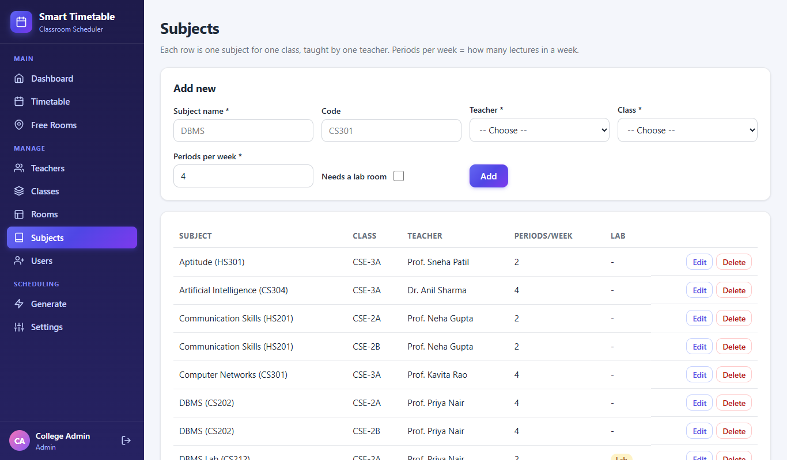
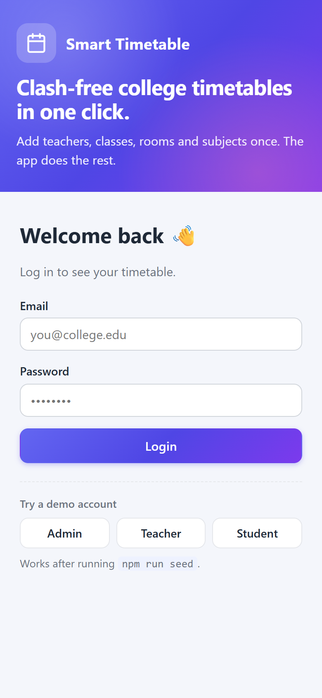
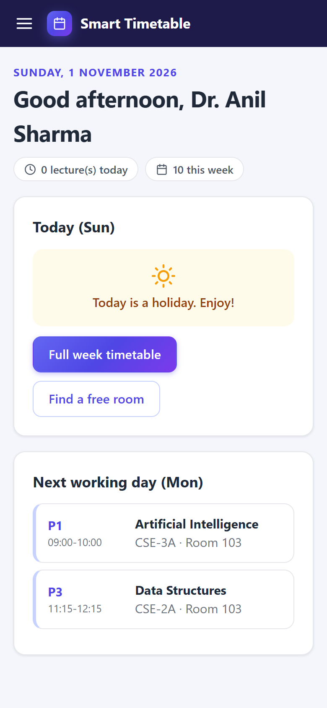
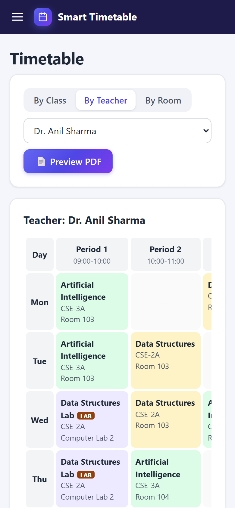
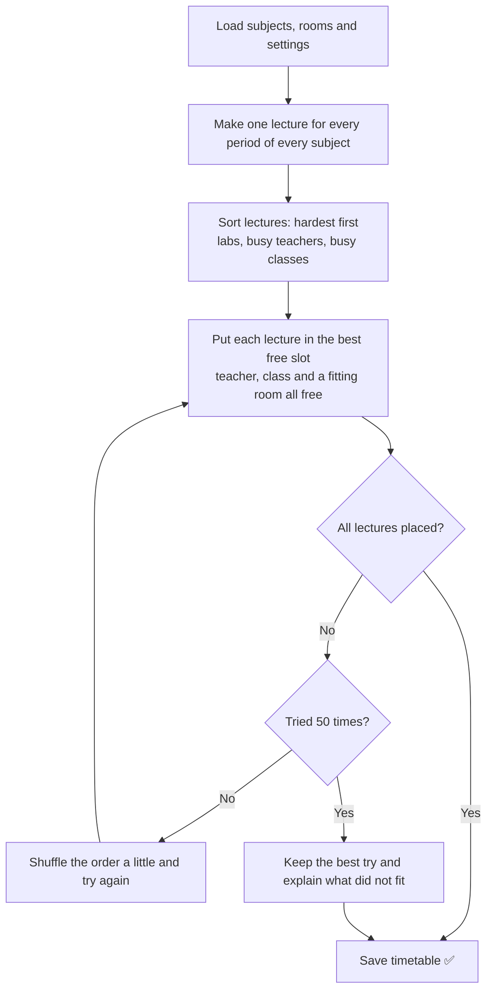

<div align="center">

# 📅 Smart Classroom and Timetable Scheduler

**Make a clash-free college timetable in one click — and find a free classroom in seconds.**


**[Features](#-features) · [Screenshots](#-screenshots) · [How it works](#-how-the-timetable-algorithm-works) · [Getting started](#-getting-started) · [Team](#-team)**

<br/>



</div>

---

## 📖 About the project

In many colleges the timetable is still made **by hand**. It takes days, and mistakes are common:
one teacher gets two lectures at the same time, two classes get the same room, or a lab subject
lands in a normal classroom.

This web app fixes that. The admin enters teachers, classes, rooms and subjects **once**, clicks
**Generate**, and the app builds a full weekly timetable with **zero clashes**. Teachers and
students log in to see their own timetable, download it as a PDF, and check which rooms are free
right now.

Built with the **MERN stack** (MongoDB, Express, React, Node.js) as a college major project.
For a deep dive into the design, read **[ARCHITECTURE.md](ARCHITECTURE.md)**.

---

## ✨ Features

| | Feature | What it does |
|---|---|---|
| 🔐 | **Role-based login** | Admin, Teacher and Student each see their own pages (JWT + bcrypt). |
| 🗂️ | **Data management** | Admin adds Teachers, Classes, Rooms, Subjects and user logins. |
| ⚡ | **One-click generator** | Builds the whole week's timetable with no teacher, class or room clash. |
| 🧪 | **Lab & capacity rules** | Lab subjects go only to labs; rooms must be big enough for the class. |
| 📆 | **Spread across days** | The same subject is placed on different days when possible. |
| 💬 | **Explains problems** | If a lecture can't fit, it says **why** in simple words (e.g. "No lab has space for 70 students"). |
| 👀 | **Three views** | See the timetable by class, by teacher or by room. |
| 📄 | **PDF export** | Preview the timetable as a PDF, then download or print it. |
| 🏫 | **Free Rooms** | See free and busy rooms for any period — or **right now**. |
| 🏠 | **Today dashboard** | Teachers and students see today's lectures (current one highlighted), and the next working day on holidays. |
| 🚀 | **One-click demo login** | Admin, Teacher and Student buttons on the login page — perfect for a quick demo. |
| 📱 | **Mobile friendly** | Works on phones, tablets and computers. |

---

## 📸 Screenshots

<table>
  <tr>
    <td width="50%" align="center"><b>Login (with one-click demo accounts)</b><br/><br/></td>
    <td width="50%" align="center"><b>Generate the timetable in one click</b><br/><br/></td>
  </tr>
  <tr>
    <td width="50%" align="center"><b>Clash-free weekly timetable</b><br/><br/></td>
    <td width="50%" align="center"><b>Find a free room</b><br/><br/></td>
  </tr>
  <tr>
    <td width="50%" align="center"><b>Manage subjects, teachers, classes and rooms</b><br/><br/></td>
    <td width="50%" align="center"><b>Works on phones too</b><br/><br/>
      
      
      
    </td>
  </tr>
</table>

---

## 🧠 How the timetable algorithm works

The scheduler lives in [`server/services/scheduler.js`](server/services/scheduler.js).
It uses a **greedy algorithm with random restarts**.



**Hard rules (never broken)**

1. A teacher teaches only one lecture in a period.
2. A class attends only one lecture in a period.
3. A room holds only one lecture in a period.
4. Lab subjects go to labs, others go to classrooms, and the room must fit the whole class.
5. Every subject gets its "periods per week".

**Soft rule (followed when possible):** don't put the same subject twice on the same day.

---

## 🛠️ Tech stack

| Part | Technology |
|---|---|
| Frontend | React 19, React Router 7, Vite, Axios, jsPDF + jsPDF-AutoTable |
| Backend | Node.js, Express 5 |
| Database | MongoDB with Mongoose 9 |
| Security | JSON Web Tokens (JWT), bcrypt password hashing, role checks on every route |

---

## 🚀 Getting started

### 1. What you need

- **Node.js 20 or newer** → <https://nodejs.org>
- **MongoDB**, either:
  - **MongoDB Community Server** on your computer (runs on `mongodb://127.0.0.1:27017`), or
  - a free **MongoDB Atlas** cloud database.

### 2. Download the code

```bash
git clone https://github.com/kratagy44/smart-classroom-timetable-scheduler.git
cd smart-classroom-timetable-scheduler
```

### 3. Set up the backend

```bash
cd server
npm install
cp .env.example .env
```

Open `server/.env` and fill it in:

```env
PORT=5000
MONGO_URI=mongodb://127.0.0.1:27017/smart_timetable
JWT_SECRET=put_a_long_random_secret_here
```

Then add sample data and start the server:

```bash
npm run seed
npm run dev
```

You should see `MongoDB connected` and `Server running on http://localhost:5000`.

> ⚠️ `npm run seed` **deletes all old data** and adds fresh sample data. Run it only once.

### 4. Start the frontend (in a second terminal)

```bash
cd client
npm install
npm run dev
```

Open **<http://localhost:5173>** in your browser. 🎉

### 🔑 Demo logins (created by `npm run seed`)

| Role | Email | Password |
|---|---|---|
| Admin | `admin@college.edu` | `admin123` |
| Teacher | `anil.sharma@college.edu` | `teacher123` |
| Student | `cse2a@college.edu` | `student123` |

💡 Tip: on the login page just click **Admin**, **Teacher** or **Student** under *Try a demo account*, then **Login**.

All 8 sample teachers use `teacher123`. Students `cse2a`, `cse2b` and `cse3a` `@college.edu` use `student123`.

### 📦 Run everything as one server (optional)

```bash
cd client
npm run build
cd ../server
npm start
```

Now open **<http://localhost:5000>** — the backend also serves the built React app.

---

## 🎤 Demo steps (for viva / presentation)

1. Log in as **Admin** → show the dashboard counts.
2. Open **Teachers, Classes, Rooms, Subjects** → add one item to show the forms work.
3. Open **Generate** → show the "Before you generate" check → click **⚡ Generate Timetable**.
4. Open **Timetable** → switch between *By Class*, *By Teacher*, *By Room* → **Preview PDF** → **Download**.
5. Open **Free Rooms** → change day/period, then click **Right now**.
6. Show bad data handling: in **Settings** set periods per day to 3 and generate again.
   The app lists which subjects did not fit and why. (Set it back to 6 afterwards.)
7. Log out, log in as a **Teacher** → show "Today" and the teacher's own timetable.

---

## 🔌 API overview

All routes start with `/api`. Every route except login needs the header `Authorization: Bearer <token>`.

| Method | Route | Who | What it does |
|---|---|---|---|
| POST | `/auth/login` | everyone | Log in, get a token |
| GET | `/auth/me` | logged in | Who am I |
| GET / POST / PUT / DELETE | `/teachers`, `/classes`, `/rooms`, `/subjects` | read: logged in · change: admin | Manage master data |
| GET / POST / DELETE | `/users` | admin | Manage login accounts |
| GET / PUT | `/settings` | read: logged in · change: admin | Working days and period times |
| POST | `/timetable/generate` | admin | Run the scheduler |
| GET | `/timetable`, `/timetable/class/:id`, `/timetable/teacher/:id`, `/timetable/room/:id` | logged in | Read the timetable |
| GET | `/rooms/free?day=Mon&period=2` | logged in | Free and busy rooms for a period |

---

## 📁 Project structure

```
smart-classroom-timetable-scheduler/
├── client/                  React frontend (Vite)
│   └── src/
│       ├── api/             Axios setup (adds the login token)
│       ├── components/      Sidebar, CrudPage, TimetableGrid, PdfPreview ...
│       ├── context/         AuthContext (who is logged in)
│       ├── pages/           Dashboard, Generate, Timetable, Free Rooms, ...
│       └── utils/           PDF maker, time helpers
├── server/                  Node.js + Express backend
│   ├── controllers/         Request handlers
│   ├── middleware/          Login check and role check
│   ├── models/              MongoDB schemas (User, Teacher, Room, Subject, ...)
│   ├── routes/              API routes
│   ├── seed/                Sample data script
│   └── services/
│       └── scheduler.js     ⭐ The timetable algorithm
├── docs/                    Project synopsis and screenshots
├── ARCHITECTURE.md          Full design explanation
└── README.md
```

---

## ❓ Troubleshooting

| Problem | Fix |
|---|---|
| `Could not connect to MongoDB` | Start MongoDB (Windows: Services → MongoDB → Start), or check `MONGO_URI` in `server/.env`. |
| `JWT_SECRET is missing` | Copy `server/.env.example` to `server/.env` and fill it in. |
| Login page says "Cannot reach the server" | The backend is not running. Run `npm run dev` in the `server` folder. |
| Port 5000 already in use | Change `PORT` in `server/.env` and the same port in `client/vite.config.js`. |
| Timetable lists problems | Read the reason column: add rooms, add periods per day, or reduce periods per week. |

---

## 👥 Team

**Department of Computer Engineering — Major Project**

| Role | Name |
|---|---|
| Team Leader | Harshita Jangid |
| Team Member | Kratagy Jain |
| Team Member | Mayank |
| Team Member | Piyush Bhardwaj |
| Project Guide | Ms. Chitra Thinger, Assistant Professor |

📄 Project synopsis: [`docs/`](docs/)

---

## 📜 License

This project is released under the [MIT License](LICENSE).

<div align="center">
<br/>

Made with ❤️ by the Smart Timetable team · ⭐ Star this repo if you found it useful!

</div>
